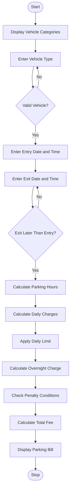

# Smart-Parking
# Smart Parking Fee Management System

## 1. Project Overview

The Smart Parking Fee Management System is a Python-based application designed to calculate parking charges automatically based on vehicle categories, entry and exit times, overnight parking, daily fee limits, and penalty conditions.

The system validates user inputs and generates a detailed parking bill.

## 2. Problem Statement

Parking fee calculation can become complicated when different vehicle categories have different hourly rates, vehicles remain parked overnight, and additional penalties or daily limits are applied.

This project provides an automated solution to calculate accurate parking fees while validating date and time inputs.

## 3. Objectives

- Calculate parking fees based on vehicle categories.
- Accept entry and exit date and time.
- Validate date and time inputs.
- Calculate parking duration.
- Apply overnight parking charges.
- Implement maximum daily parking limits.
- Apply penalties for lost tickets and long parking durations.
- Generate a detailed parking bill.

## 4. Technologies Used

- Programming Language: Python
- Concepts: Variables, Dictionaries, Functions, Loops, Conditional Statements, Exception Handling
- Module: datetime
- Library: math

## 5. Vehicle Categories and Charges

| Vehicle | Hourly Rate | Daily Limit |
|---|---:|---:|
| Car | ₹30 | ₹200 |
| Bike | ₹15 | ₹100 |
| Bus | ₹60 | ₹400 |
| Truck | ₹50 | ₹350 |

### Additional Charges

| Condition | Charge |
|---|---:|
| Overnight parking (per midnight crossed) | ₹50 |
| Lost parking ticket | ₹200 |
| Parking duration above 24 hours | ₹300 |

## 6. Assumptions

1. Parking charges are calculated according to the selected vehicle category.
2. Every started hour is rounded up to the next whole hour.
3. Each calendar day's parking charge is calculated separately.
4. The daily maximum limit applies to the hourly parking fee.
5. An overnight charge of ₹50 is applied for every midnight crossed.
6. A lost ticket results in a ₹200 penalty.
7. Parking duration exceeding 24 hours results in a ₹300 penalty.
8. Exit time must be later than entry time.
9. Date and time must follow the format YYYY-MM-DD HH:MM.

## 7. Algorithm

1. Start the program.
2. Display the vehicle categories and hourly rates.
3. Accept the vehicle category from the user.
4. Validate the selected vehicle category.
5. Accept the parking entry date and time.
6. Validate the entry date and time.
7. Accept the exit date and time.
8. Check whether exit time is later than entry time.
9. Calculate parking hours for each calendar day.
10. Calculate the parking fee using the hourly rate.
11. Apply the maximum daily parking limit.
12. Calculate overnight charges.
13. Check lost-ticket and long-stay conditions.
14. Add applicable penalties.
15. Display the final parking bill.
16. Stop the program.

## 8. Pseudocode

```text
START

DISPLAY vehicle categories and rates

INPUT vehicle_type

IF vehicle_type is invalid
    DISPLAY error
    ASK again
END IF

INPUT entry_datetime
VALIDATE entry_datetime

REPEAT
    INPUT exit_datetime
UNTIL exit_datetime > entry_datetime

INPUT lost_ticket_status

CALCULATE parking hours for each day

FOR each parking day
    CALCULATE hourly fee
    APPLY daily maximum limit
    ADD daily fee to total
END FOR

CALCULATE overnight charges
ADD overnight charges

IF lost_ticket_status is YES
    ADD lost ticket penalty
END IF

IF parking duration > 24 hours
    ADD long stay penalty
END IF

DISPLAY parking details
DISPLAY total parking fee

STOP
```

## 9. Flowchart



## 10. Test Cases

| Test | Vehicle | Entry | Exit | Expected Result |
|---|---|---|---|---|
| 1 | Car | 2026-11-25 10:00 | 2026-11-25 12:00 | ₹60 |
| 2 | Bike | 2026-11-25 10:00 | 2026-11-25 13:00 | ₹45 |
| 3 | Car | 2026-11-25 22:00 | 2026-11-26 02:00 | ₹170 |
| 4 | Car | 2026-11-25 08:00 | 2026-11-25 16:00 | ₹200 |
| 5 | Bus | 2026-11-25 08:00 | 2026-11-26 10:00 | ₹390 |
| 6 | Car | 2026-11-25 10:00 | 2026-11-25 12:00 | ₹260 (lost ticket) |
| 7 | Bike | 2026-11-25 08:00 | 2026-11-26 10:00 | ₹230 (long stay) |
| 8 | Car | 2026-11-25 12:00 | 2026-11-25 10:00 | Invalid exit time |

*The test cases use the charging rules and rates defined in the Python program.*

## 11. Sample Output

```text
=============================================
     SMART PARKING FEE MANAGEMENT
=============================================

Vehicle Categories:
Car - Rs. 30/hour
Bike - Rs. 15/hour
Bus - Rs. 60/hour
Truck - Rs. 50/hour

Enter vehicle type: car

Enter entry date and time:
2026-11-25 10:00

Enter exit date and time:
2026-11-25 12:00

Is the parking ticket lost? (yes/no): no

----- PARKING DETAILS -----

2026-11-25 | 2 hours | Rs. 60

----- BILL SUMMARY -----

Vehicle Type: CAR
Total Hours: 2.00
Overnight Charge: Rs. 0
Penalty: Rs. 0

Total Parking Fee: Rs. 60
```

## 12. Conclusion

The Smart Parking Fee Management System successfully automates parking fee calculations using Python.

It handles different vehicle categories, parking durations, overnight charges, daily limits, and penalty conditions. It also validates user inputs to prevent incorrect calculations.

This project demonstrates the practical application of Python programming concepts in solving a real-world parking management problem.

## 13. Project Structure

```text
Smart-Parking-Fee-Management/
│
├── smart_parking.py
├── README.md
│
└── Screenshots/
    ├── output1.png
    ├── output2.png
    └── output3.png
```

## 14. How to Run the Project

1. Install Python 3 on your computer.
2. Download or clone the GitHub repository.
3. Open the project folder in VS Code.
4. Open the terminal.
5. Run the following command:

```bash
python smart_parking.py
```

6. Enter the vehicle category, entry time, exit time, and ticket status.
7. View the calculated parking bill.

---

**Project Title:** Smart Parking Fee Management System
name:sree hasini
section:5

**Language:** Python

**Project Type:** Case Study – Python Activity-Based Learning
